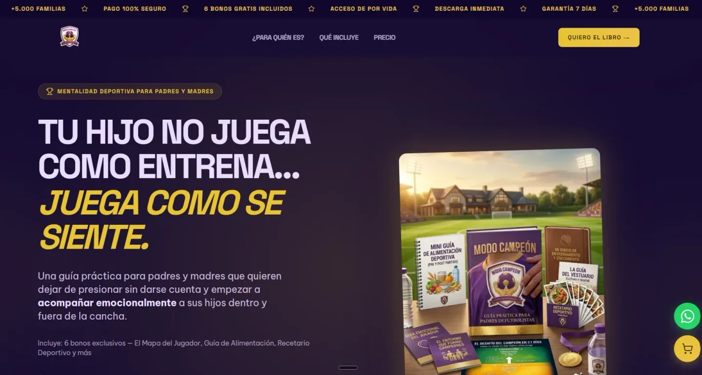
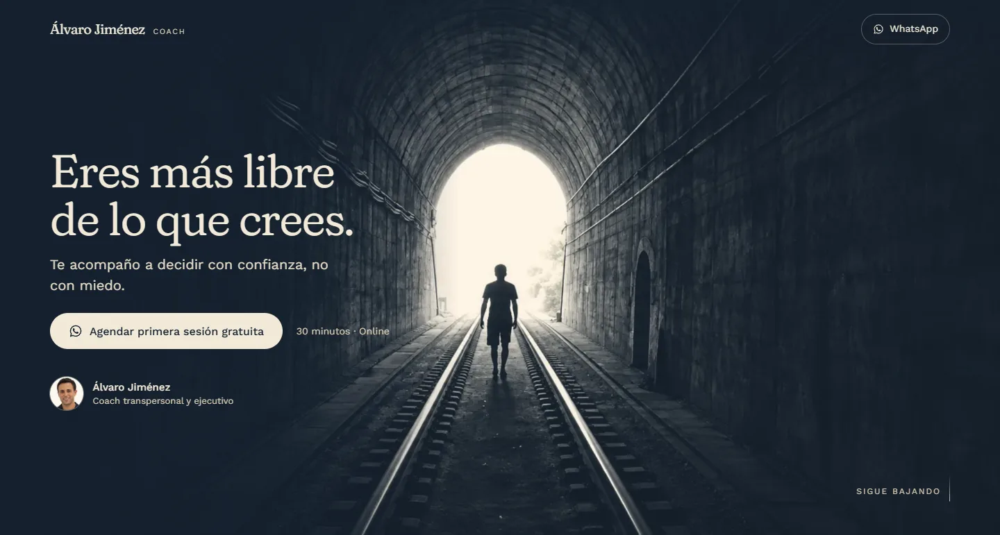
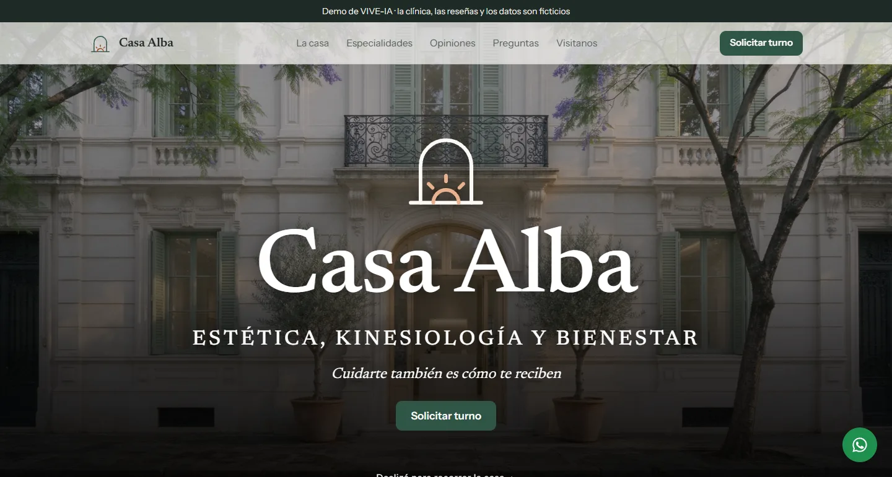
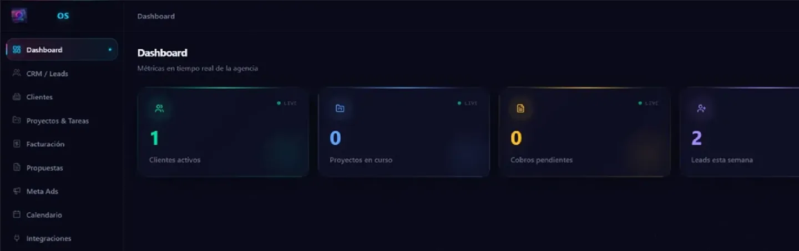

# Desarrollos personalizados — VIVE-IA

> Creamos páginas web, landing pages y aplicaciones web adaptadas exactamente a lo que necesitás. Sin templates genéricos, sin soluciones enlatadas.

Desarrollo a medida

# Desarrollos personalizados  
para tu negocio

Creamos páginas web, landing pages y aplicaciones web adaptadas exactamente a lo que necesitás. Sin templates genéricos, sin soluciones enlatadas.

Lo que hacemos

## Cada proyecto, construido desde cero

No usamos plantillas. Cada producto que entregamos está pensado y construido para tu negocio específico.

### Sitios web corporativos

Tu presencia digital profesional. Diseño único, rápido, optimizado para SEO y adaptado a todos los dispositivos.

### Landing pages de alta conversión

Páginas diseñadas para vender. Estructura persuasiva, orientada a resultados y lista para campañas publicitarias.

### Aplicaciones web a medida

Dashboards, portales de clientes, CRMs o herramientas internas. Desarrolladas con tecnologías modernas y escalables.

### Integraciones con IA

Sumamos inteligencia artificial a tu sitio o app: agentes conversacionales, automatizaciones, generación de contenido y más.

Webs y landing pages

## Todo lo que incluye tu web

Sea una landing para vender o el sitio completo de tu empresa, cada web sale con esto resuelto.

### Diseño propio para tu marca

Tipografías, colores y fotos pensados para tu negocio. Nada de plantillas compradas ni sitios que se parecen a todos.

### Rápida en cualquier pantalla

Liviana y con animaciones fluidas en celular, tablet y computadora. Tus clientes no esperan a que cargue.

### Lista para Google

SEO técnico, datos estructurados y vista previa al compartir, para que tu negocio se muestre bien en buscadores y redes.

### WhatsApp y formularios conectados

Botones a WhatsApp con el mensaje listo y formularios que llegan directo a tus automatizaciones, tu CRM o tus planillas.

### Segura desde el primer día

HTTPS, cabeceras de seguridad y formularios protegidos contra spam y abusos.

### Publicada y funcionando

Nos ocupamos del hosting, el dominio y la puesta en línea. Antes de publicar, revisás y aprobás cada pantalla.

Proyectos

## Algunos de nuestros trabajos

Cada proyecto resuelve un problema real con tecnología bien aplicada.

Landing page

### Modo Campeón

Landing page de alta conversión para infoproducto. Integración con Hotmart, ticker animado, diseño 100% orientado a ventas.

[Ver proyecto](https://modocampeon.store)

Landing page

### Álvaro Jiménez · Coach

Landing para un coach online: la página arranca dentro de un túnel y, al bajar, la cámara avanza hacia la luz. Primera sesión gratuita por WhatsApp.

[Ver proyecto](https://alvaro-coach.netlify.app/)

Sitio institucional · Demo

### Casa Alba

Demo de sitio para una clínica de estética y bienestar: recorrido por la casa con el scroll, especialidades, opiniones y preguntas frecuentes. La clínica y sus datos son ficticios.

[Ver demo](https://demo-clinicas-vive.netlify.app/)

App a medida

### Aplicación Personalizada

Aplicación web interna para gestión de agencia: dashboard, CRM, clientes, proyectos, facturación y calendario.

## ¿Tenés un proyecto en mente?

Contanos qué necesitás y te proponemos la solución más eficiente para tu negocio.

[Agendar una llamada](https://cal.com/demo-vive-ia-fuz5y7/30min?user=demo-vive-ia-fuz5y7) [Escribinos por WhatsApp](https://wa.me/5492665258874)

---
Fuente: https://vive-ia.com/desarrollos
