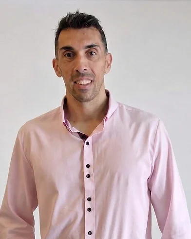
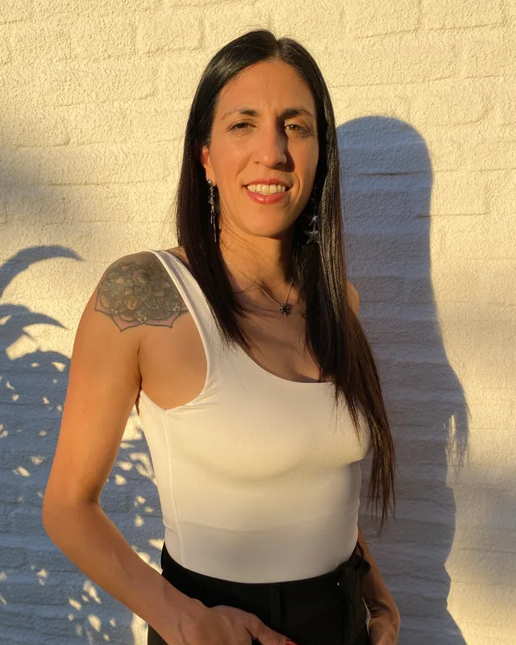

# Quiénes Somos — VIVE-IA

> Conocé a Pablo y Luciana Frisardi, fundadores de VIVE-IA. Estrategia, tecnología y propósito para transformar tu negocio.

Quiénes somos

# Somos Pablo y Luciana. Tecnología y negocio en el mismo equipo.

Pablo Frisardi Construye tu sistema

Luciana Frisardi Entiende tu negocio

Fundamos VIVE-IA para que tu empresa crezca sin caos: primero ordenamos tus procesos y después los automatizamos con inteligencia artificial.

+20 años en tecnología · Pablo

+18 años en negocios y estrategia · Luciana

[Agendar diagnóstico gratuito](/contacto) Conocenos en video

Manifiesto VIVE-IA

> “No reemplazamos personas. Liberamos su potencial. Nuestra misión es devolverle al humano el tiempo para ser humano, mientras la tecnología se encarga de lo predecible.”

Nacimos de la convicción de que la inteligencia artificial no es solo una herramienta tecnológica, sino un catalizador de libertad creativa. En VIVE-IA, transformamos la fricción operativa en fluidez estratégica, permitiendo que las empresas respiren, innoven y crezcan sin las ataduras de las tareas repetitivas.

No llegamos con soluciones predefinidas. Escuchamos, entendemos y diseñamos sistemas a medida que resuelven los problemas reales de tu negocio — con tecnología que tiene propósito.

Las personas detrás

## Con quién vas a trabajar

Más de 38 años de experiencia combinada en tecnología y negocios, al servicio de tu crecimiento. Cada uno se ocupa de una parte del proceso.

### Luciana Frisardi

Cofundadora · Estrategia & Negocios

En tu proyecto · entiende tu negocio

-   01 Diagnóstico Entendemos tu flujo actual y detectamos cuellos de botella.
-   02 Orden Optimizamos procesos antes de tocar una sola línea de código.

Con más de 18 años asesorando empresas en procesos de transformación y crecimiento estratégico, Luciana es la brújula que conecta la tecnología con los objetivos reales de cada negocio. Su experiencia abarca múltiples industrias, desde pymes hasta organizaciones de mayor escala.

Su mirada estratégica garantiza que cada automatización no sea solo eficiente, sino que tenga impacto medible en la operación y en los resultados. Luciana asegura que la IA se implemente con propósito, no por moda.

### Pablo Frisardi

Cofundador · IA & Automatización

En tu proyecto · construye tu sistema

-   03 Sistematización Creamos la infraestructura robusta que soportará la IA.
-   04 Automatización con IA Desplegamos agentes inteligentes que ejecutan y aprenden.

Con más de 20 años en tecnología, Pablo es el arquitecto técnico detrás de cada solución de VIVE-IA. Especialista en inteligencia artificial, automatización de procesos e integración de sistemas complejos, ha liderado proyectos de transformación digital en empresas de múltiples industrias.

Su enfoque diferencial radica en traducir la complejidad tecnológica en sistemas simples, robustos y escalables. Para Pablo, la mejor automatización es la que nadie nota porque simplemente funciona — 24 horas al día, todos los días.

Lo que nos mueve

## Propósito, misión y visión

Propósito

Que cualquier negocio, del tamaño que sea, pueda automatizar con la eficiencia de las grandes empresas.

Misión

Diseñar e implementar sistemas inteligentes que eliminen el ruido operativo, para que te enfoques en lo que realmente importa.

Visión

Ser referentes en integrar IA de forma ética y eficiente, construyendo un futuro donde el trabajo sea sinónimo de creación.

Lo que nos define

## Nuestros valores

-   01
    
    ### Tecnología con propósito
    
    La innovación solo vale si resuelve un problema real.
    
-   02
    
    ### Orden antes que automatización
    
    No automatizamos el caos; primero diseñamos el orden.
    
-   03
    
    ### Eficiencia con sentido humano
    
    Empatía en el diseño, precisión en la ejecución.
    
-   04
    
    ### Impacto real
    
    Medimos nuestro éxito por los resultados tangibles de nuestros clientes.
    
-   05
    
    ### Evolución constante
    
    En la frontera de la IA, el aprendizaje nunca se detiene.
    

Siguiente paso

## ¿Tu negocio está listo para automatizar?

Agendá una sesión de diagnóstico y descubrí cómo la IA puede transformar tu operación diaria.

[Agendar diagnóstico gratuito](/contacto) [Escribir por WhatsApp](https://wa.me/5492665258874)

---
Fuente: https://vive-ia.com/quienes-somos
