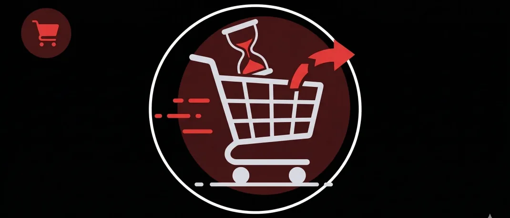

# Agentes IA para E-commerce — VIVE-IA

> Automatizá tu tienda online con agentes conversacionales. Recuperá carritos, mejorá la atención y vendé más las 24hs.

Inteligencia Conversacional

# Agentes conversacionales para  
E-commerce

Transformá tu tienda online con IA que vende, atiende y fideliza 24/7. Reducí el abandono de carritos y escalá tus ventas sin aumentar el equipo.

[Agendar diagnóstico gratuito](/contacto) [Escribinos por WhatsApp](https://wa.me/5492665258874)

 Mirá el video La IA no sirve para vender más

24/7

Atención sin horario

4+

Plataformas de e-commerce

30 min

Diagnóstico gratuito

El problema

## ¿Tu E-commerce sufre de estos problemas?

### Carritos abandonados

Muchos clientes se van sin comprar porque nadie les responde a tiempo.

### Tareas manuales

Tu equipo pierde horas respondiendo "¿dónde está mi pedido?" o "¿tienen stock?".

### Baja retención

Sin un seguimiento post-venta personalizado, los clientes rara vez vuelven a comprar.

### Falta de integración

Tus sistemas no hablan entre sí, causando fricción en el proceso de compra.

### Soporte lento

Tiempos de respuesta superiores a 2 horas matan la intención de compra del usuario.

### Escalabilidad nula

En épocas de alta demanda (Hot Sale, Navidad), tu equipo colapsa y perdés ventas.

La solución

## ¿Qué es un agente conversacional?

No es un simple chatbot. Es un experto en ventas digital que entiende el contexto, conoce tu catálogo y actúa proactivamente para cerrar ventas, tal como lo haría tu mejor vendedor.

-   #### Atención Instantánea 24/7
    
    Respuestas en menos de 3 segundos, siempre disponible.
    
-   #### Venta Sugestiva Inteligente
    
    Recomienda productos basados en el comportamiento del usuario.
    
-   #### Gestión de Logística Automática
    
    Rastreo de pedidos e incidencias sin intervención humana.
    

👤

Hola, ¿tienen la zapatilla en talle 42?

🤖

¡Claro! Tenemos stock en talle 42. También te cuento que hoy tiene 15% off. ¿Te lo reservo? 🎉

👤

Sí, perfecto. ¿Cómo pago?

🤖

Te envío el link de pago ahora mismo 👇

IA activa 24/7

Aplicaciones

## Casos de Uso Especializados

Soluciones para los dos pilares críticos de cualquier tienda online exitosa.

🛒

### Recuperación proactiva de ventas

Cuando un usuario abandona el checkout, el agente inicia una conversación personalizada ofreciendo ayuda, resolviendo dudas de envío o aplicando un cupón temporal.

-   Reactivación vía WhatsApp
-   Cupones dinámicos
-   Manejo de objeciones de precio

🎧

### Resolución Autónoma de Soporte

Centralizá todas las consultas de post-venta. El agente se conecta a tu ERP/Logística para dar estados reales de envío y gestionar cambios o devoluciones.

-   Tracking de pedidos 24/7
-   FAQ dinámica contextual
-   Derivación humana inteligente

Beneficios

## Potenciá cada aspecto de tu operación

#### Escala masiva

Atendé a 1 o 10.000 personas al mismo tiempo sin degradar la calidad.

#### Data Analytics

Descubrí por qué tus clientes no compran y optimizá tu catálogo con insights reales.

#### Multilenguaje

Vendé en cualquier mercado. Tu agente habla más de 50 idiomas con fluidez.

#### Omnicanalidad

Mismo cerebro en WhatsApp, Instagram, Web y Facebook Messenger.

#### Seguridad garantizada

Tratamiento de datos personales bajo los más altos estándares internacionales.

#### Setup Rápido

Implementación en menos de 15 días con entrenamiento personalizado.

Armá tu agente

## Elegí qué querés que haga tu agente

Marcá lo que necesitás y mandanos el resumen por WhatsApp. Te respondemos con una propuesta a medida para tu tienda.

1 ¿Dónde vendés?

 Tienda Nube Shopify  WooCommerce  MercadoShops  Otra plataforma

2 ¿Qué querés que haga?

 Consultas de productos, envíos y pagos Responde al instante sobre productos, envíos y medios de pago. Recomendación de productos Asesora y sugiere productos según lo que busca cada cliente.  Recuperación de carritos Le escribe a quien dejó el carrito para ayudarlo a terminar la compra.  Post-compra y recompra Embudos post-compra y remarketing para que vuelvan a comprar.  Calificación de clientes Detecta el interés de cada cliente y los segmenta.  Derivación a tu equipo Pasa la conversación a una persona cuando hace falta.  Reportes de conversaciones y ventas Reportes de interacción y conversión para decidir con datos.  Integración con tu CRM Conecta clientes y pedidos con tus herramientas.

### Tu agente

Para Tienda Nube

-   Consultas de productos, envíos y pagos

[Enviar por WhatsApp](https://wa.me/5492665258874?text=Hola%20VIVE-IA%2C%20vengo%20de%20la%20web%20y%20quiero%20armar%20un%20agente%20para%20mi%20tienda.%20%C2%BFMe%20ayudan%20con%20el%20diagn%C3%B3stico%3F) [Prefiero agendar un diagnóstico gratuito](/contacto)

Todos los proyectos incluyen onboarding, soporte, mantenimiento y mejoras continuas. Contratación mínima: 6 meses.

¿Listo para escalar?

## ¿Listo para transformar tus visitas en clientes leales?

Sumáte a las tiendas que ya están escalando su facturación con nuestra tecnología conversacional.

[¡Lo necesito!](/contacto) [Escribir por WhatsApp](https://wa.me/5492665258874)

---
Fuente: https://vive-ia.com/soluciones/ecommerce
